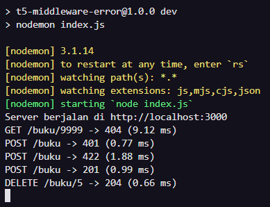
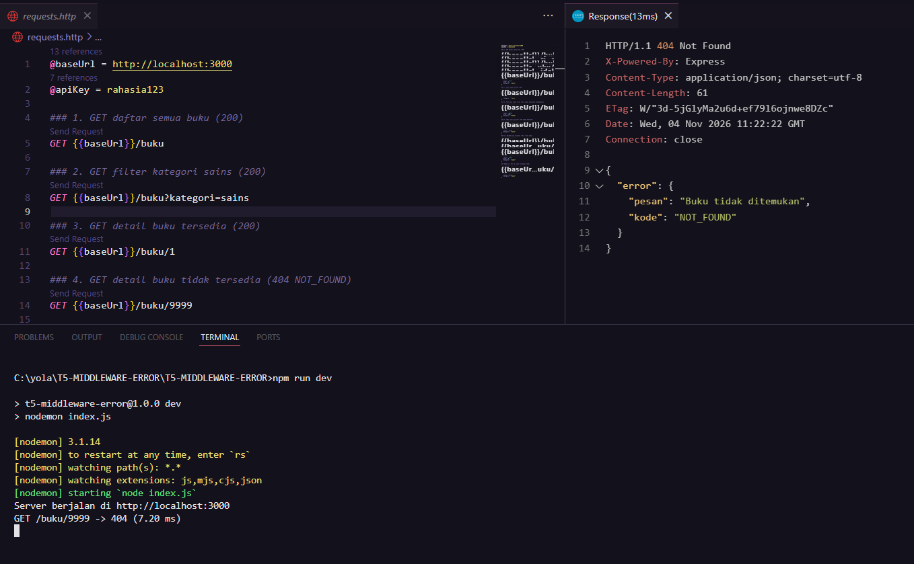
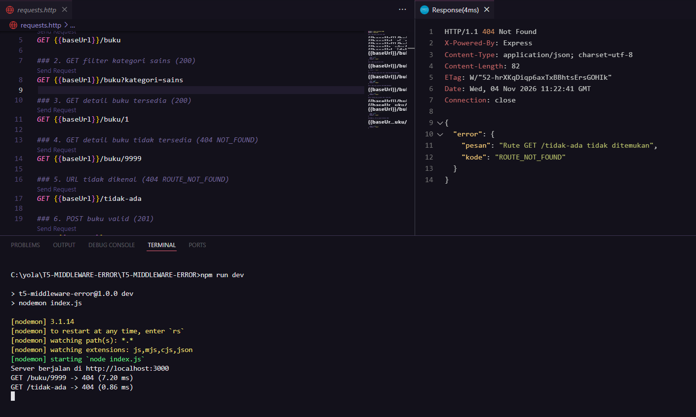
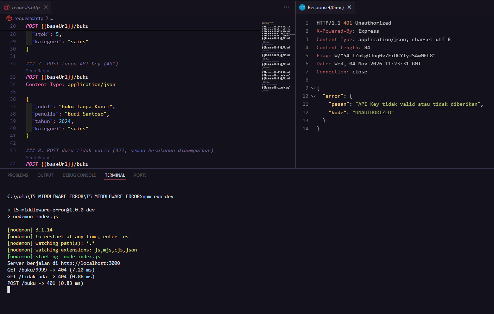
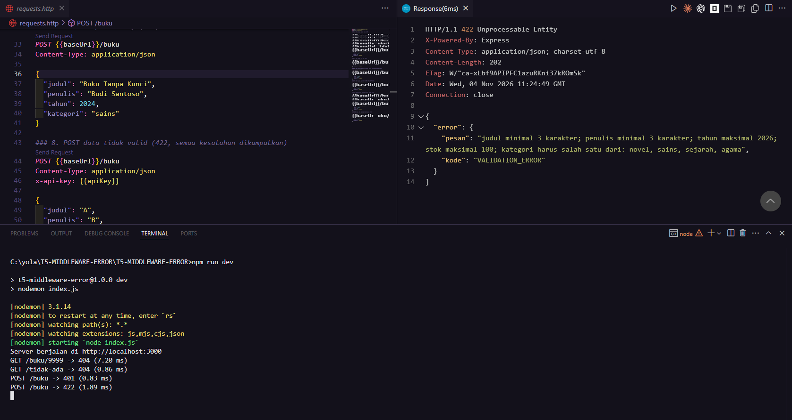
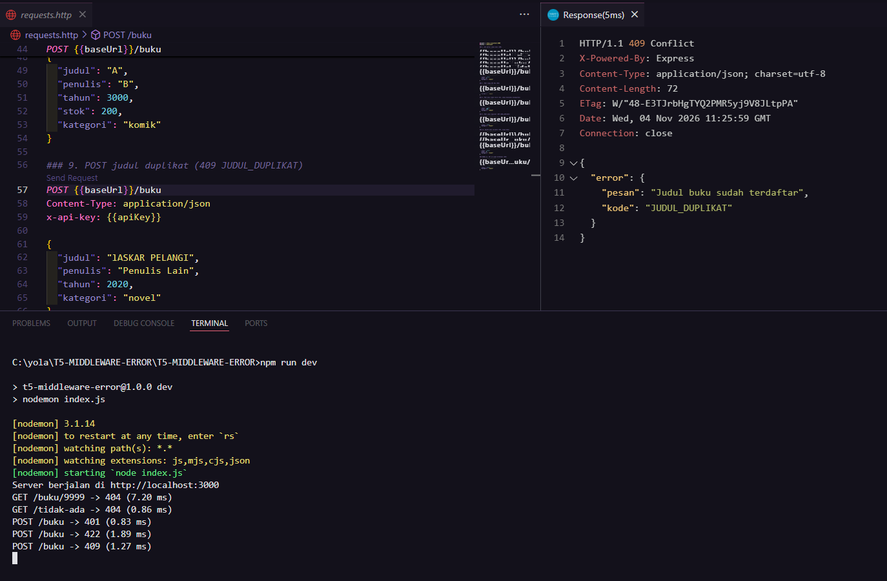
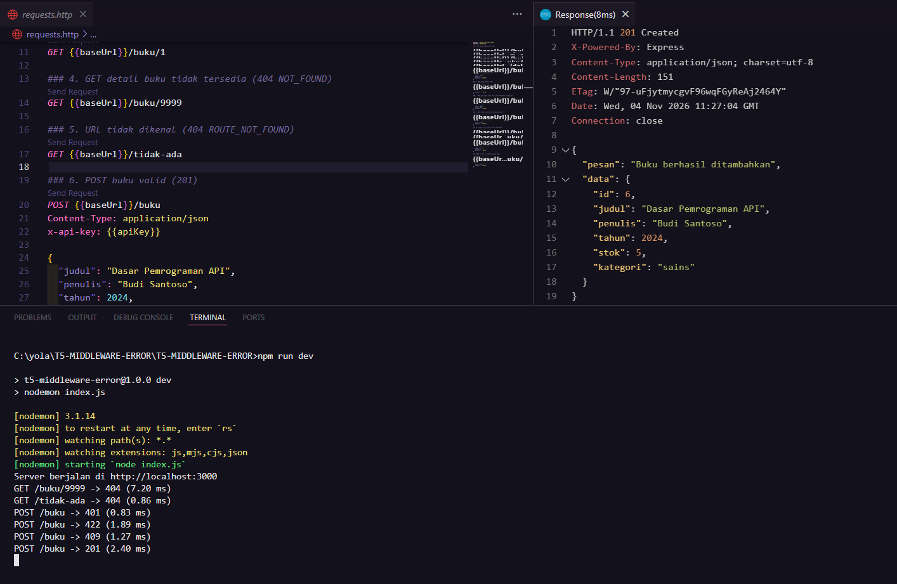
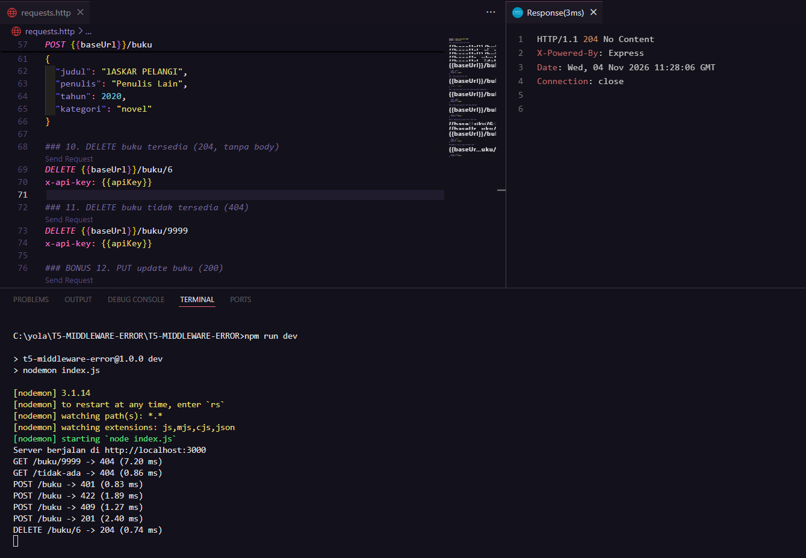
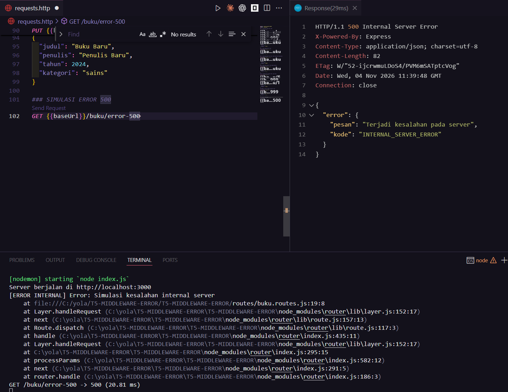

# Tugas 5 - Middleware & Error Terpusat

## Identitas

- Nama: BAIQ ERWINA YOLANDA
- NIM: F1D02410039
- Varian: A - Perpustakaan (`/buku`)
- Mata kuliah: Pemrograman Web Lanjut

## Deskripsi

Proyek ini merupakan REST API sederhana untuk mengelola koleksi buku menggunakan Node.js, Express 5, Joi, middleware, dan centralized error handling. Data buku disimpan sementara di memori, jadi data akan kembali ke data awal ketika server dijalankan ulang.

## Cara Menjalankan

1. Pastikan Node.js dan npm sudah terpasang.
2. Ekstrak ZIP, lalu buka folder proyek di VS Code.
3. Jalankan `npm install`.
4. Salin file `.env.example` menjadi `.env`.
5. Isi file `.env`, contohnya:

   ```env
   PORT=3000
   API_KEY=rahasia123
   ```

6. Jalankan server dengan `npm run dev`.
7. Buka file `requests.http` di VS Code. Jalankan setiap request dengan tombol **Send Request** dari ekstensi REST Client.

**Catatan API Key:** Untuk request yang membutuhkan autentikasi, kirim header `x-api-key` dengan nilai yang sama seperti `API_KEY` di file `.env`. Jika API Key tidak ada atau salah, server akan mengembalikan status `401 Unauthorized`.

## Endpoint

| Method | URL                    | Fungsi                                | Hasil utama                 |
| ------ | ---------------------- | ------------------------------------- | --------------------------- |
| GET    | `/buku`                | Menampilkan semua buku                | 200                         |
| GET    | `/buku?kategori=sains` | Menampilkan buku berdasarkan kategori | 200                         |
| GET    | `/buku/:id`            | Menampilkan detail buku               | 200 / 404                   |
| POST   | `/buku`                | Menambahkan buku                      | 201 / 401 / 422 / 409       |
| DELETE | `/buku/:id`            | Menghapus buku                        | 204 / 401 / 404             |
| PUT    | `/buku/:id`            | Memperbarui buku (bonus)              | 200 / 401 / 404 / 409 / 422 |

## Aturan Validasi dan Bisnis

- `judul`: wajib berupa teks dengan panjang 3 sampai 100 karakter.
- `penulis`: wajib berupa teks dengan panjang minimal 3 karakter.
- `tahun`: wajib berupa bilangan bulat dari 1900 sampai 2026.
- `stok`: bilangan bulat dari 0 sampai 100. Jika tidak diisi, nilai awalnya 1.
- `kategori`: wajib diisi dengan salah satu nilai `novel`, `sains`, `sejarah`, atau `agama`.
- Validasi Joi menggunakan `abortEarly: false`, jadi beberapa kesalahan input bisa dikirim sekaligus dalam satu respons `422`.
- Judul buku tidak boleh duplikat. Pemeriksaan dilakukan tanpa membedakan huruf besar dan kecil. Jika judul sudah terdaftar, API mengembalikan `409 JUDUL_DUPLIKAT`.

## Middleware dan Penanganan Error

- `logger` mencatat method, URL, status HTTP, dan waktu respons setiap request.
- `cekApiKey` memeriksa API Key pada request yang membutuhkan autentikasi.
- `notFound` menangani URL atau route yang tidak tersedia.
- `errorHandler` menjadi tempat penanganan error terpusat. Untuk error internal, detail teknis dicatat di terminal, sedangkan client hanya menerima pesan umum.
- `AppError` digunakan untuk membuat error operasional dengan status dan kode tertentu.

Format respons error dibuat konsisten:

```json
{
  "error": {
    "pesan": "Pesan kesalahan",
    "kode": "KODE_ERROR"
  }
}
```

## Kode Error

| HTTP | Kode                    | Keterangan                                     |
| ---- | ----------------------- | ---------------------------------------------- |
| 401  | `UNAUTHORIZED`          | API Key tidak ada atau tidak sesuai            |
| 404  | `NOT_FOUND`             | Data buku tidak ditemukan                      |
| 404  | `ROUTE_NOT_FOUND`       | URL atau route tidak dikenal                   |
| 409  | `JUDUL_DUPLIKAT`        | Judul buku sudah terdaftar                     |
| 422  | `VALIDATION_ERROR`      | Data yang dikirim tidak sesuai aturan validasi |
| 500  | `INTERNAL_SERVER_ERROR` | Terjadi kesalahan internal pada server         |

## Pengujian

Pengujian dilakukan melalui file `requests.http` menggunakan ekstensi REST Client di VS Code. Request dijalankan satu per satu, lalu status dan isi respons diperiksa di panel Response. Aktivitas request juga diperiksa melalui log di terminal.

Skenario yang diuji meliputi:

1. GET daftar buku dan filter kategori.
2. GET detail buku yang tersedia.
3. GET buku yang tidak ditemukan (404).
4. GET URL yang tidak dikenal (`ROUTE_NOT_FOUND`).
5. POST tanpa API Key (401).
6. POST dengan data tidak valid (422).
7. POST dengan judul yang sudah terdaftar (409).
8. POST buku dengan data valid (201).
9. DELETE buku yang tersedia (204).
10. Simulasi error internal (500).
11. PUT untuk memperbarui buku dan PUT dengan ID yang tidak ditemukan sebagai pengujian bonus.

### Bukti Screenshot

Screenshot berikut merupakan hasil pengujian yang dijalankan pada komputer menggunakan REST Client dan terminal. File gambar disimpan di folder `screenshot/`.

#### 1. Logger terminal

Memperlihatkan log request dengan status 404, 401, 422, 201, dan 204.



#### 2. GET detail buku tidak ditemukan (404)



#### 3. URL tidak dikenal (404 ROUTE_NOT_FOUND)



#### 4. POST tanpa API Key (401)



#### 5. POST data tidak valid (422)



#### 6. POST judul duplikat (409)



#### 7. POST buku berhasil ditambahkan (201)



#### 8. DELETE buku berhasil (204)



#### 9. Simulasi error internal (500)

Screenshot ini memperlihatkan respons error pada sisi client dan detail error pada terminal.



## Cara Pengujian Error 500

Untuk menguji error 500, dibuat endpoint simulasi sementara pada `routes/buku.routes.js`. Endpoint tersebut meneruskan objek Error ke middleware menggunakan `next(new Error(...))`. Request kemudian dijalankan melalui REST Client pada alamat `/buku/error-500`.

Hasil pengujian:

- Client menerima status `500 Internal Server Error` dengan pesan umum `Terjadi kesalahan pada server`.
- Terminal menampilkan label `[ERROR INTERNAL]`, detail error, dan log request dengan status 500.

## Deklarasi Penggunaan AI

Dalam pengerjaan tugas ini, saya menggunakan AI sebagai teman diskusi dan alat bantu teknis. Secara umum, pembagian kontribusinya kurang lebih seimbang: AI membantu memberikan rancangan, contoh kode, dan arahan ketika ada bagian yang perlu diperbaiki; saya sendiri menyiapkan dan menjalankan proyek, memeriksa kode, menyesuaikan konfigurasi, melakukan pengujian, serta memastikan hasilnya sesuai.

| Pekerjaan                     | Bantuan AI                                                                              | Pekerjaan yang saya lakukan                                                                                                     |
| ----------------------------- | --------------------------------------------------------------------------------------- | ------------------------------------------------------------------------------------------------------------------------------- |
| Memahami struktur proyek      | Memberikan gambaran pembagian folder dan alur routes, controllers, services, serta data | Membuka dan mempelajari struktur proyek, lalu memeriksa fungsi setiap bagian                                                    |
| Middleware dan error handling | Memberikan contoh dan penjelasan logger, API Key, notFound, AppError, dan errorHandler  | Memeriksa urutan middleware dan menjalankan server untuk melihat hasilnya                                                       |
| Validasi dan aturan data      | Membantu menyusun contoh aturan validasi Joi dan penanganan judul duplikat              | Mencoba data valid dan tidak valid, lalu memeriksa respons yang diberikan API                                                   |
| Pengujian endpoint            | Membantu menyiapkan contoh request dan menjelaskan status HTTP yang diharapkan          | Menjalankan request satu per satu di REST Client, membandingkan hasilnya, dan mengambil screenshot                              |
| Error 500                     | Memberikan arahan untuk membuat simulasi error sementara dan menguji errorHandler       | Menambahkan endpoint simulasi, menjalankan request, memeriksa respons client dan terminal, serta mengambil screenshot pengujian |
| Dokumentasi                   | Membantu merapikan susunan README dan penjelasan teknis                                 | Memeriksa isi dokumentasi dan menyesuaikannya dengan file serta hasil pengujian proyek                                          |

AI yang digunakan: ChatGPT.

Contoh penggunaan prompt: meminta bantuan untuk memahami struktur REST API Express, middleware, validasi Joi, dan error handler terpusat; meminta contoh request untuk menguji status HTTP; serta meminta arahan ketika memeriksa hasil pengujian.

**Pernyataan:** AI digunakan sebagai alat bantu, bukan untuk menggantikan seluruh proses pengerjaan. Saya tetap menjalankan aplikasi, mencoba setiap request, memeriksa hasil di REST Client dan terminal, serta bertanggung jawab memahami dan menyesuaikan kode yang digunakan dalam tugas ini.

## Kesimpulan dan Kendala

Dari pengerjaan ini, saya memahami bahwa middleware membantu menjalankan proses yang dibutuhkan oleh beberapa endpoint, seperti pencatatan request dan pemeriksaan API Key. Penanganan error terpusat juga membuat format respons lebih konsisten. Error internal dicatat di terminal, sementara client menerima pesan umum sehingga detail teknis server tidak langsung ditampilkan.
